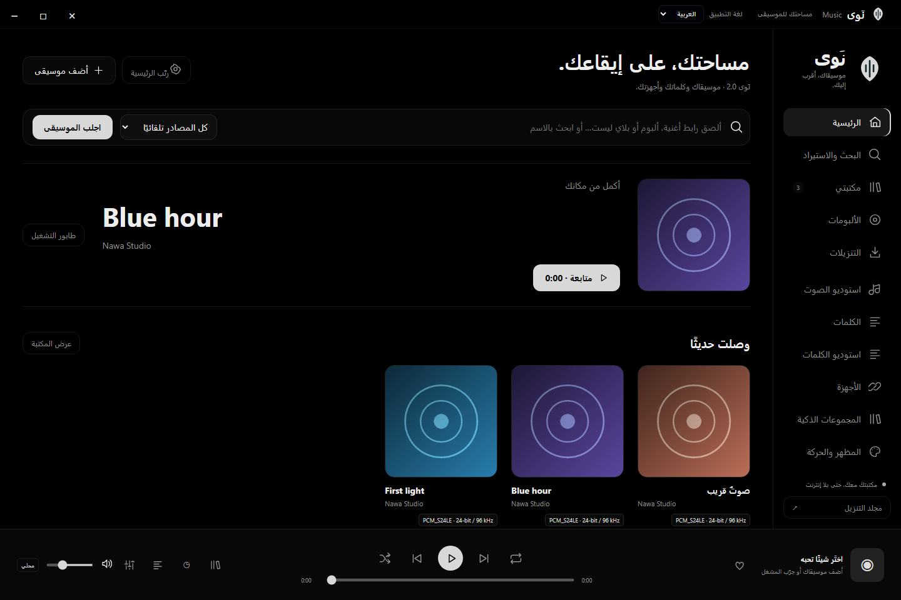
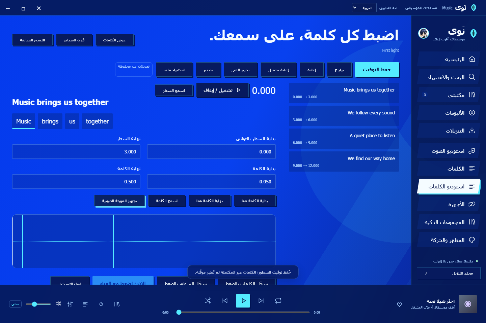
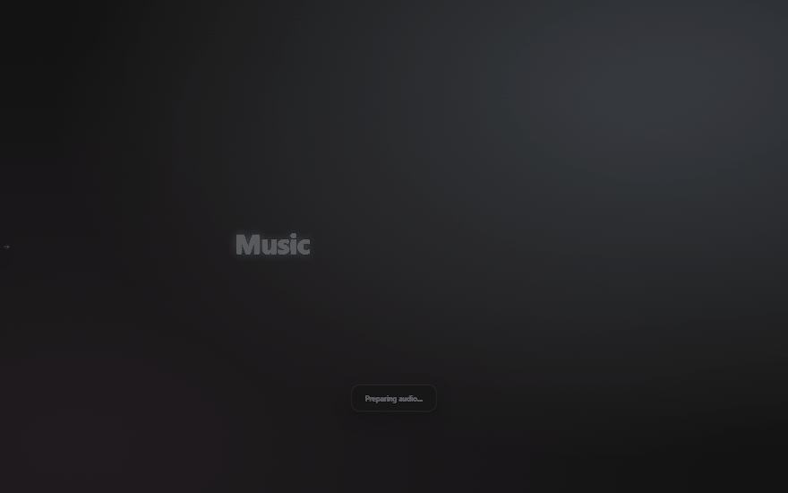
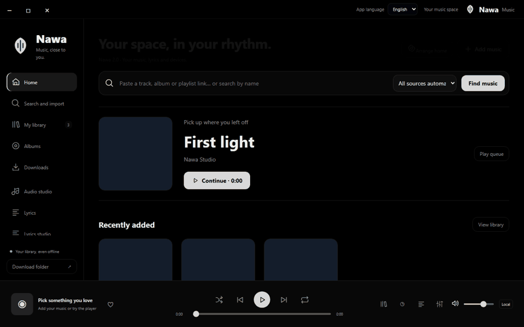
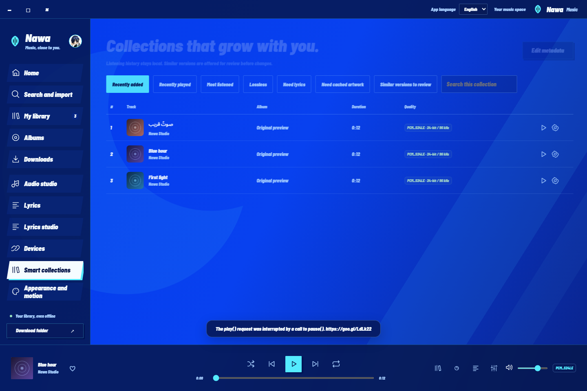
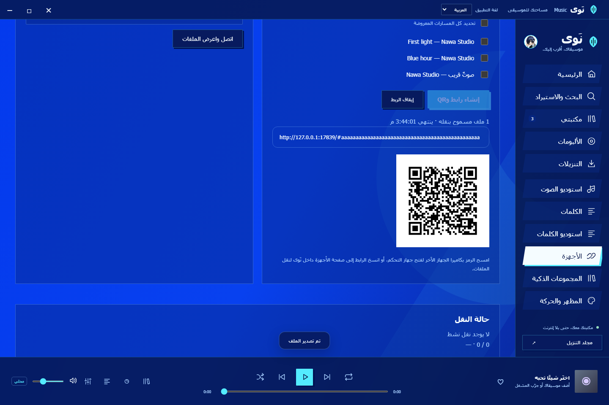
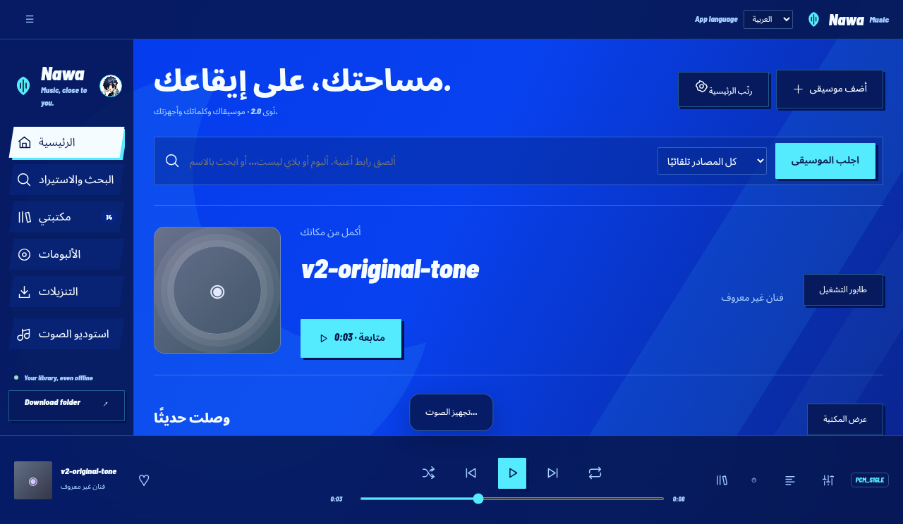
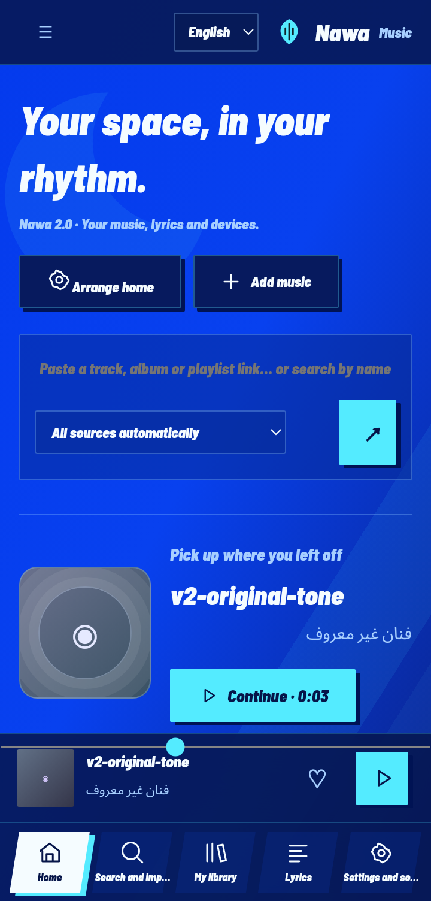

# نَوى 2.0 · Nawa

موسيقاك، كلماتك، وأجهزتك — على Windows وأندرويد.

[التنزيل](https://github.com/NSXI/music/releases/latest) · [التثبيت](docs/INSTALL-AR.md) · [جديد 2.0](docs/RELEASE-2.0-AR.md) · [التحقق وحدوده](docs/VALIDATION-AR.md)

## التنزيل

| الجهاز | الحزمة | المتطلبات |
|---|---|---|
| Windows | [Nawa-Windows-x64.zip](https://github.com/NSXI/music/releases/latest/download/Nawa-Windows-x64.zip) | Windows 10/11 x64 + WebView2 |
| الهاتف والتابلت | [Nawa-Android-Samsung-arm64.apk](https://github.com/NSXI/music/releases/latest/download/Nawa-Android-Samsung-arm64.apk) | Android 9+ ARM64 |
| مطابقة توقيت Windows، اختياري | [Nawa-Windows-Alignment.zip](https://github.com/NSXI/music/releases/latest/download/Nawa-Windows-Alignment.zip) | يُنزّل من الإعدادات عند الحاجة |
| ترجمة Windows المحلية، اختياري | [Nawa-Windows-Translation.zip](https://github.com/NSXI/music/releases/latest/download/Nawa-Windows-Translation.zip) | يُنزّل من الإعدادات عند الحاجة |

حدّث فوق النسخة السابقة للحفاظ على البيانات. أندرويد يحتاج موافقة النظام على تثبيت APK. راجع [الدليل](docs/INSTALL-AR.md) قبل نقل مجلد Windows أو تغيير جهازك.

## المميزات

- رئيسية قابلة للترتيب، ألبومات ومجلدات وجينرا ومفضلة ومجموعات ذكية وسجل استماع.
- تشغيل محلي وبث من المصادر المدعومة، بحث مجمّع حسب التسجيل، ومعاينة وجودة وصيغة معروفة قبل التنزيل.
- محرر توقيت بالموجة وسطور وكلمات وتراجع وسجل مصادر، وتحليل مقطع من الصوت باختيارك ومراجعتك.
- كلمات محفوظة وترجمة ونطق تضيفه بنفسك؛ 107 أشكال و15 حركة مع الخطوط والمعاينات.
- شاشة كلمات كاملة، أوضاع عرض متعددة وتصميم محفوظ لكل أغنية أو قائمة، وثيمات الألعاب والخلفيات السابقة.
- تداخل بين الأغاني وطبقة مستقلة وLUFS ومؤقت نوم وإعدادات للسماعات.
- طابور بحد مسار أو مسارين، جدولة وشبكة وسرعة، ومراجعة نسخة أعلى جودة قبل استبدال المسار في المكتبة مع بقاء الأصل.
- مشاركة محلية مؤقتة برمز QR مع فحص الملفات، ونسخ احتياطية ومزامنة HTTPS WebDAV يدوية اختيارية.
- إصدار مشترك للمنصتين وتحديثات داخل التطبيق مع فحص البصمة.

### استوديو الكلمات والحركات

التأثيرات مربوطة بساعة الصوت. حرف بحرف تقدّم بصري داخل زمن الكلمة؛ الترجمة تتبع نافذة الأصل ولا تحمل توقيت نطق مستقلًا.

### الثيمات والمكتبة والأجهزة

### الهاتف والتابلت

هذه لقطات من التطبيق بمكتبة اختبار معزولة. ليست قياسًا لأداء جهاز سامسونج فعلي. دعم Dolby وHi-Res يعتمد على الجهاز ومسار الإخراج، والتحميل يعتمد على الملف المتاح وصلاحيات المصدر. لا يُتجاوز المحتوى المحمي ولا تُسمّى الملفات المضغوطة Lossless لمجرد التحويل.

## English

Nawa 2.0 is an independent Windows and Android music player with a shared bilingual interface, cached lyrics/artwork, a waveform timing editor, local device transfers, portable backup, optional WebDAV sync and in-app release checks. Install over the previous signed Android version to retain data. Windows model engines are optional downloads. Artwork/lyric providers and audio quality depend on available authorized sources. Character reveal and translated-text progress are visual effects, not measured phoneme alignment. See the installation guide and validation report for platform-specific limits.

## البناء والتراخيص

المصدر في `desktop/` و`android/`. اختبارات CI تبني نسخ اختبار؛ توقيع إصدار Android الخاص غير موجود في المستودع. تراخيص المكتبات والخطوط والأصول في ملفات `THIRD-PARTY.md` و`licenses/`. لا يتضمن المصدر مكتبتك أو حساباتك أو ملفات موسيقى أو مفاتيح توقيع.
