

# نَوى · Nawa

مساحتك للموسيقى — على Windows وأندرويد.

مكتبة محلية، كلمات متحركة وترجمة، وثيمات تتبع ذوقك.

[دليل التثبيت](docs/INSTALL-AR.md) · [المميزات](#المميزات) · [الإصدارات](https://github.com/NSXI/music/releases) · [تفاصيل الاختبار](docs/VALIDATION-AR.md)

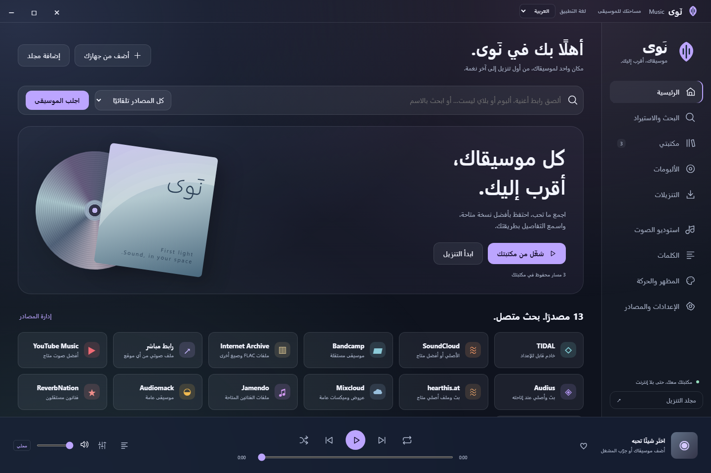

## التنزيل

| الجهاز | ملف التثبيت | المتطلبات |
|---|---|---|
| بي سي | `Nawa-Windows-x64.zip` | Windows 10/11 بنواة x64 وWebView2 |
| جوال وتابلت | `Nawa-Android-Samsung-arm64.apk` | Android 9 فأحدث، ARM64 |

الحزمتان تشتركان في المصدر والإصدار. نسخة ARM64 نفسها مهيأة لـ Galaxy Tab S10 Ultra وGalaxy S10+ وأجهزة متوافقة أخرى.

[تنزيل Windows](https://github.com/NSXI/music/releases/latest/download/Nawa-Windows-x64.zip) · [تنزيل Android APK](https://github.com/NSXI/music/releases/latest/download/Nawa-Android-Samsung-arm64.apk)

### على الجوال والتابلت

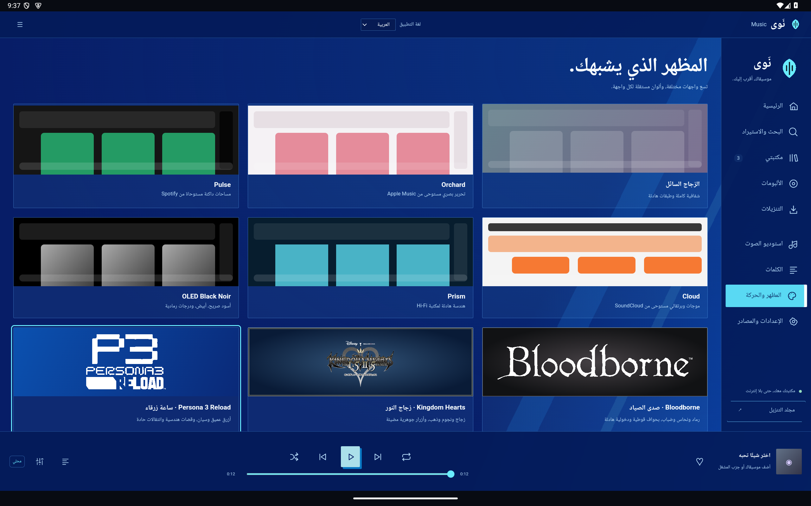

## المميزات

### تحديث 1.3 · ثيمات الألعاب

دمج التصاميم المعتمدة لـ Kingdom Hearts وBloodborne وPersona3Reload، بأزرار وخطوط ورمزيات مختلفة وثلاث حركات كلمات تتبع الصوت والترجمة. من «تفاصيل ثيمات الألعاب» تستطيع ربط الكلمات بالثيم أو حفظ خطوطك وأشكالك لكل واحد. تتوفر الخطوط دون إنترنت، مع خيار إخفاء الخلفية الفنية والرمزيات. خط Reload هو Barlow بديلًا بصريًا وليس Rodin الأصلي.

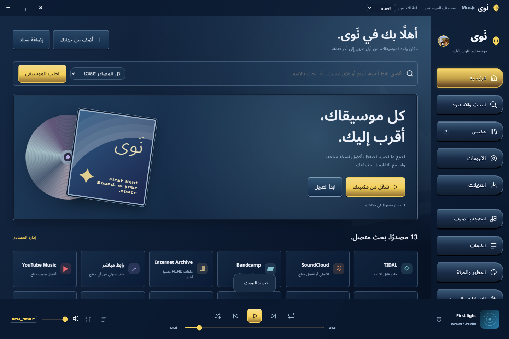

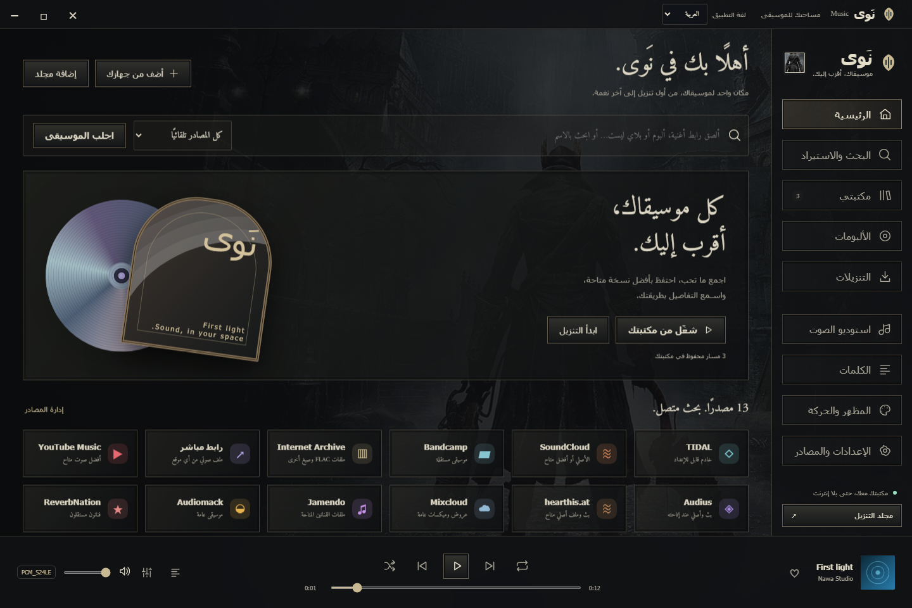

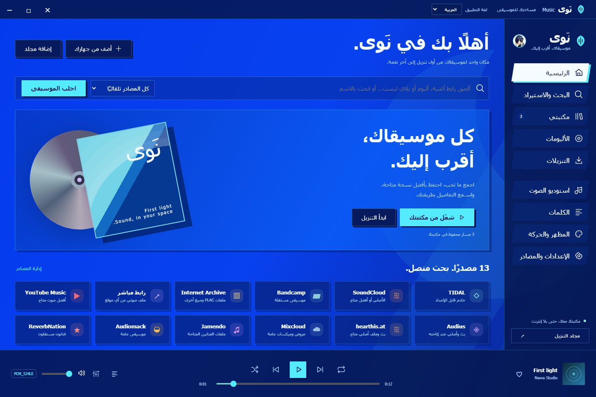

### ثيمك، بكل تفاصيله

تسعة ثيمات، ألوان قابلة للتعديل، OLED Black Noir، وزجاج داخل الواجهة. ثيمات مستوحاة من Bloodborne وKingdom Hearts وPersona 3 Reload، مع شعاراتها ودخوليات مختلفة. هوية نَوى مستقلة.

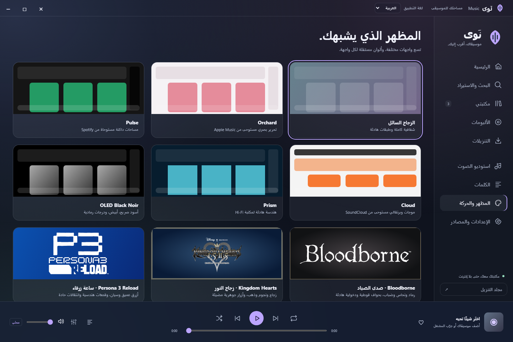

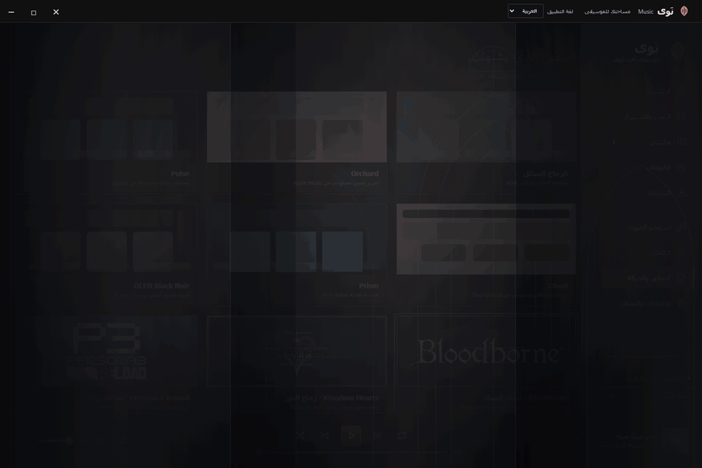

### الكلمات تتحرك مع المسار

107 أشكال للكلمات و15 حركة عامة، ومعاينات قبل الاختيار. عرض بالسطر أو الكلمة أو الحروف، وشاشة كاملة بست خلفيات، منها الغلاف وNoir والثيم الرئيسي. مشغل جانبي مخفي يمكن إظهاره أو تثبيته.

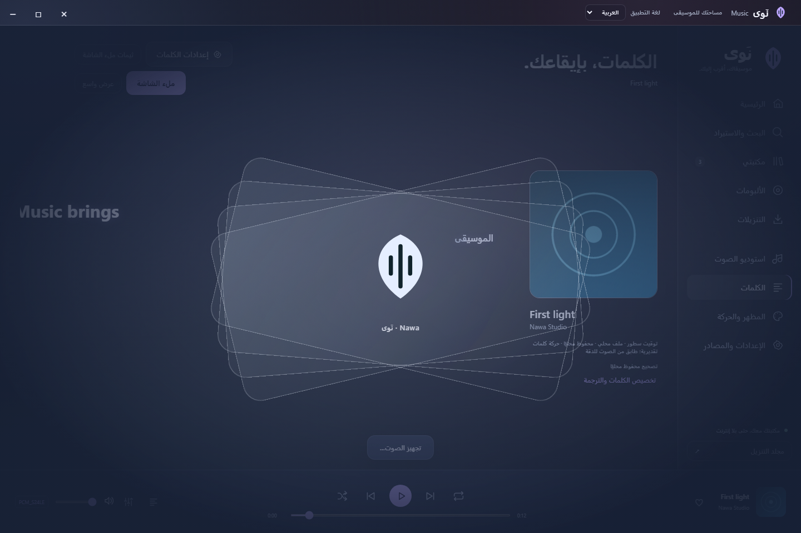

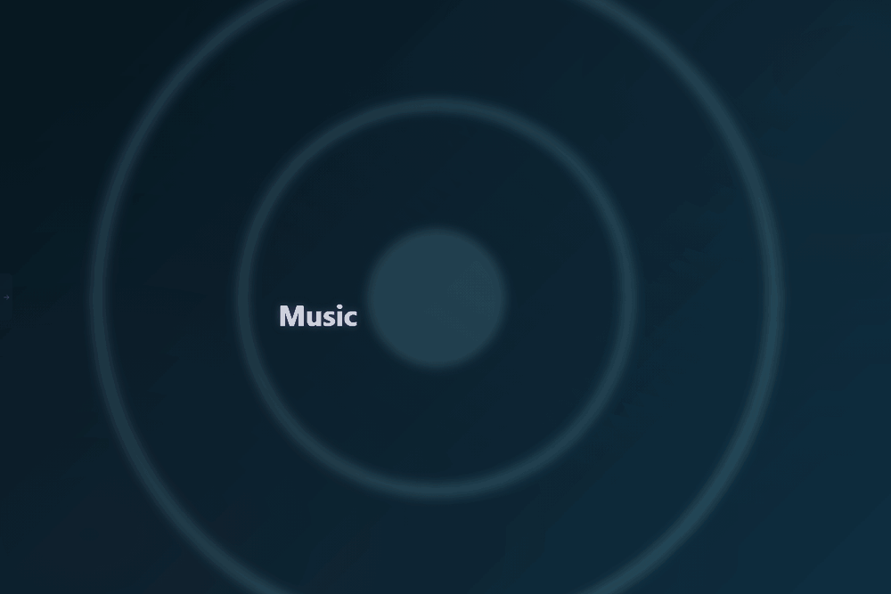

الترجمة تظهر تحت الأصل وتتبع شكله ومرحلة الكلام نفسها. توقيت المصدر يبقى محفوظًا؛ النص غير المتزامن لا يُقدّم كتوقيت مقاس. تقدير كلمات السطر وتحريك الحروف عرض بصري، ومحسن Whisper DTW يعرض نتيجة قابلة للمراجعة إذا طابقت الكلمات. لا ضمان لمطابقة أو ترجمة بلا أخطاء.

### خطوطك، للأصل والترجمة

اختيار مستقل لكل سطر، بحث في الخطوط، ومعاينات عربية وإنجليزية ويابانية وروسية. على أندرويد يمكن استيراد TTF/OTF؛ الأحرف التي لا يضمها الخط تستخدم خطًا بديلًا من النظام.

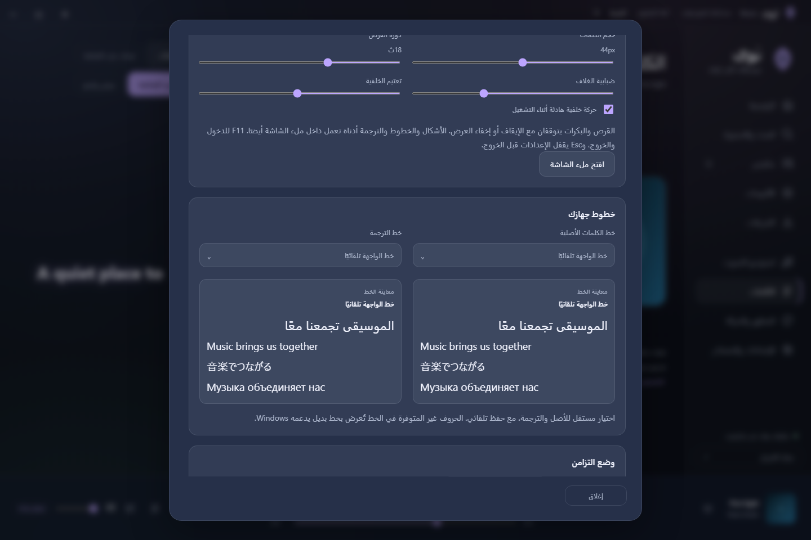

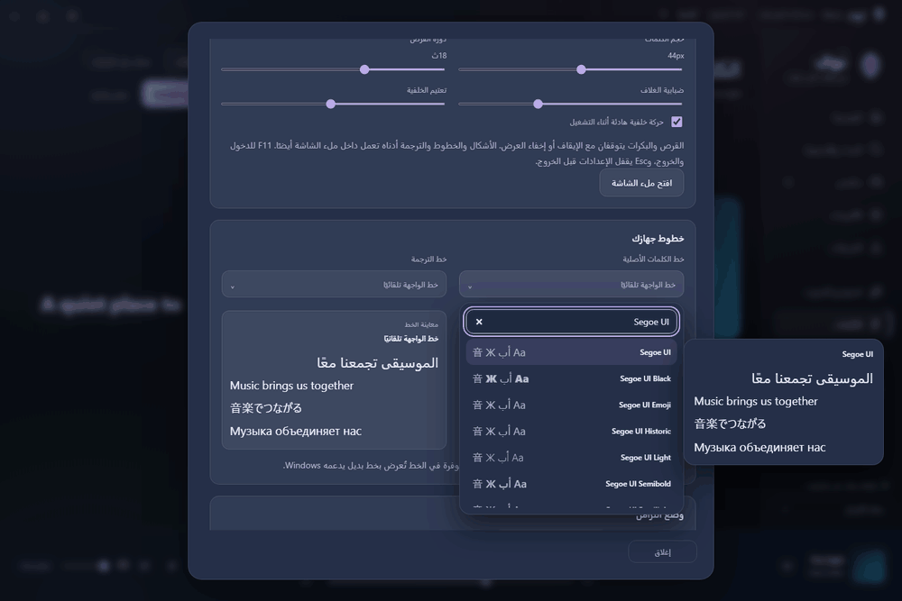

### مكتبتك أقرب

تصنيف حسب النوع، وألبومات وأغلفة وقوائم ومفضلة. استيراد ملفات أو مجلدات فرعية مع منع تكرار المحتوى، وتقدم وإلغاء وإعادة فحص. الكلمات والترجمات والأغلفة التي جُلبت تُحفظ محليًا.

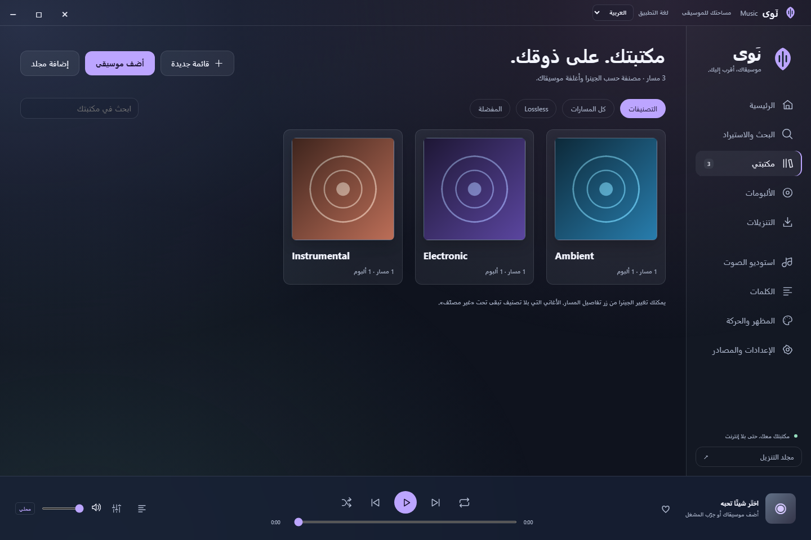

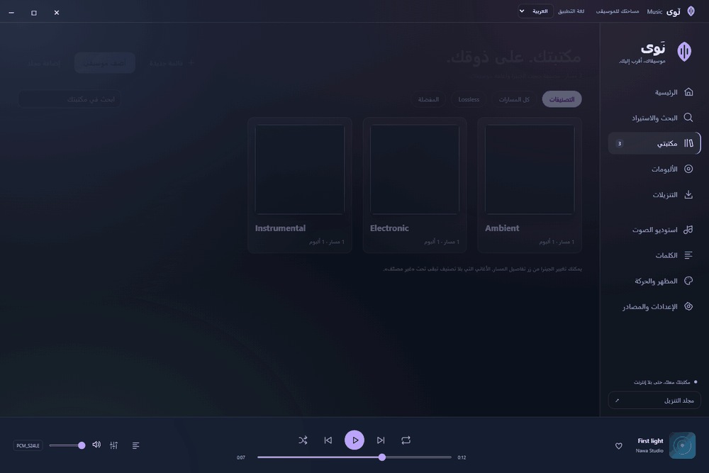

البحث يجمع موصلات 13 مصدر صوت، وSpotify للبيانات والقوائم. يمكنك تحديد المصدر، وفحص معلومات الملف، وتشغيل نتيجة متاحة قبل تنزيلها. موصلات الكلمات تشمل مصادر للعربية واليابانية والروسية ولغات أخرى؛ بعض المصادر يحتاج إعدادًا أو مفتاحًا، وليس كل تسجيل متوفرًا فيها.

### استوديو الصوت

سرعة، محافظة على الطبقة أو تغييرها، EQ وصدى وتحكم بالاتساع. أندرويد يستخدم Media3 للتشغيل بالخلفية وشاشة القفل والإشعار، مع فك صيغ إضافية بواسطة FFmpeg عند الإمكان.

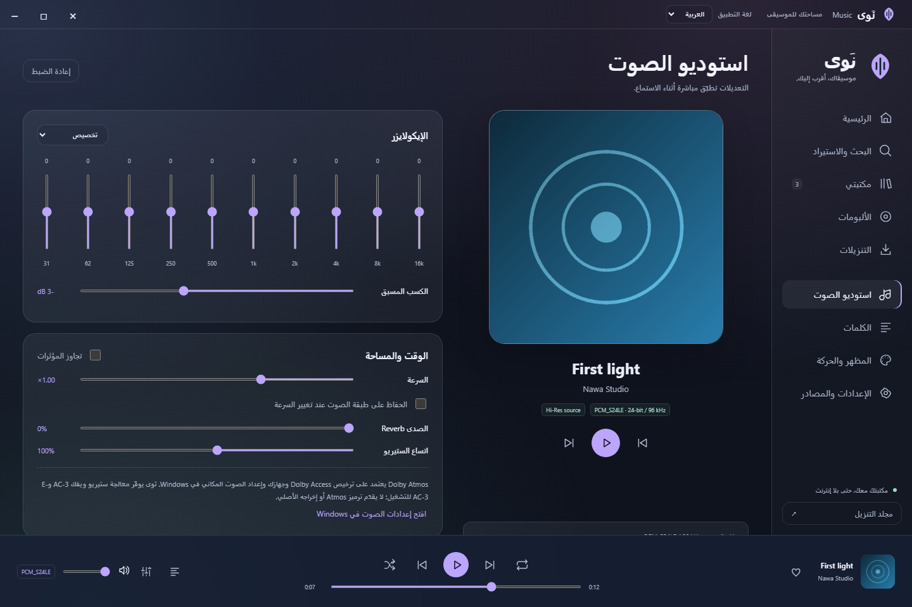

الجودة المعروضة تخص المصدر المتحقق منه؛ MP3 لا يصبح lossless بتغيير امتداده. إخراج Hi-Res وDolby يعتمد على الجهاز ومسار الصوت. مؤثرات أندرويد ونطاقات EQ الفعلية قد تختلف عن Windows؛ لا يتضمن التطبيق ترخيص Dolby مستقلًا.

### إصدار واحد للجهازين

تنبيه تحديث داخل التطبيق، وفحص عند الفتح ثم كل ساعة أثناء الاستخدام. كل إصدار يستخدم ملف تحديث مشتركًا يضم نسختي Windows وأندرويد وبصمتيهما. على الجوال يُحمّل APK من داخل التطبيق مع إيقاف واستئناف، ويُفحص حجمه وبصمته وتوقيعه واسم الحزمة وإصداره ومعالجه. زر «تثبيت التحديث» يفتح تأكيد أندرويد ويحدّث النسخة الموجودة دون حذف البيانات. موافقة النظام مطلوبة، ولا يوجد تثبيت صامت.

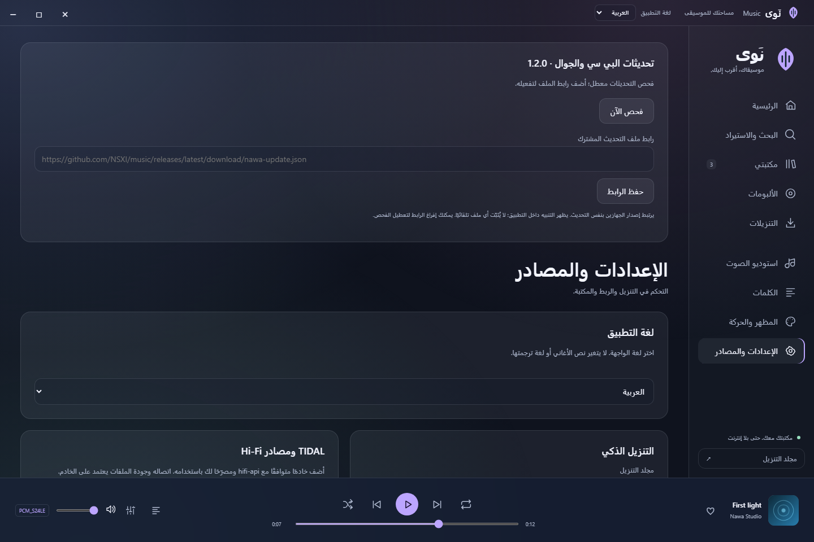

مسار البناء يزامن ملفات الواجهة والمنطق المشترك، ويحافظ على محولات أندرويد. أي تعارض أو تغيير يحتاج تنفيذًا أصليًا للجوال يوقف اعتماد الحزمة حتى يُعالَج. لا يمر تثبيت إصدار البي سي عبر مسار الإصدار إذا كانت حزمة الجوال قديمة عن المصدر نفسه.

## ملاحظات المعاينات

الصور وملفات GIF من واجهة نَوى الفعلية باستخدام مكتبة عرض محلية أصلية ومعزولة؛ لا تتضمن مكتبة المستخدم أو حساباته أو أغانيه. ملفات GIF للتوضيح، ومعدل إطاراتها ليس قياس أداء التطبيق. خيارات الرسم تبقى 60/120/144/تلقائي بحسب الشاشة والجهاز.

## التثبيت والاستخدام

الدليل المصوّر والنصائح الخاصة بالترقية والحفظ والنماذج في [دليل التثبيت العربي](docs/INSTALL-AR.md). تفاصيل الفحوص وحدودها في [سجل التحقق](docs/VALIDATION-AR.md). إعداد قناة الإصدار في [دليل النشر](docs/PUBLISHING-AR.md).

ملفات المصدر والتراخيص مرفقة. شعارات الألعاب علامات لأصحابها ولا تعني ارتباط نَوى بهم. بيانات الاعتماد ومفاتيح التوقيع وملفات المستخدم مستبعدة من حزم المصدر والنشر.
