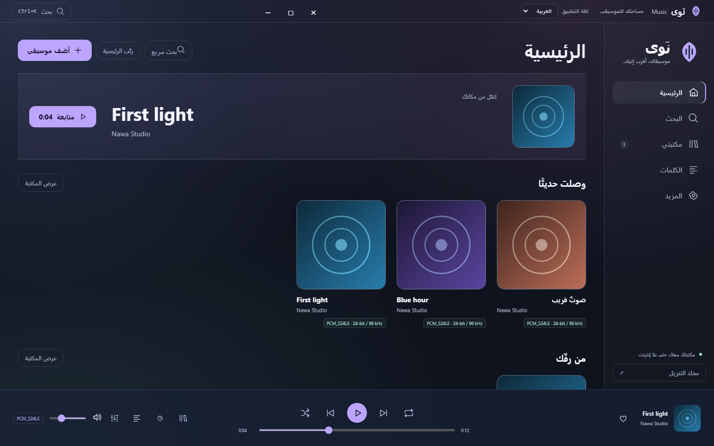
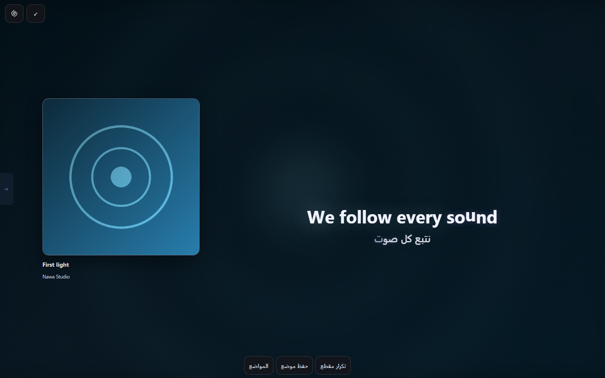
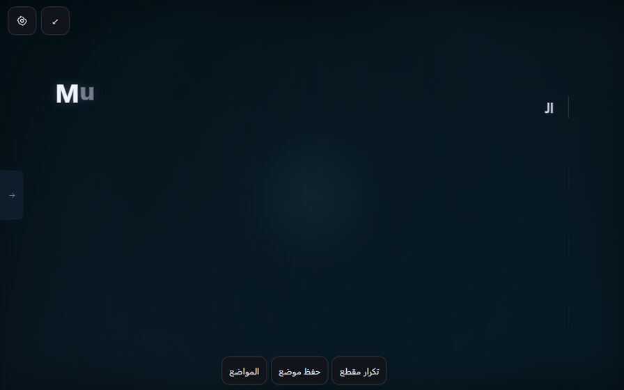
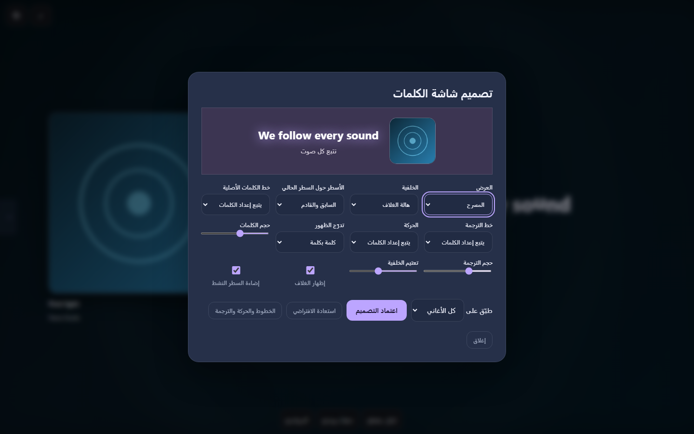
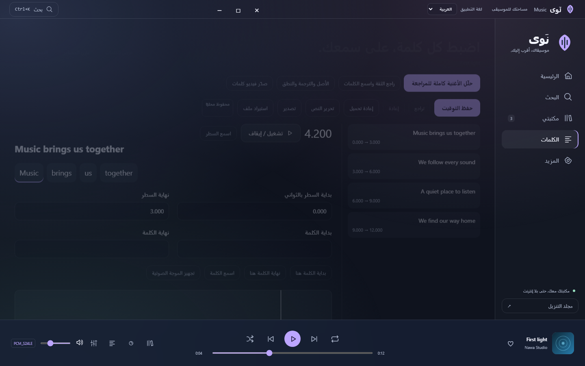
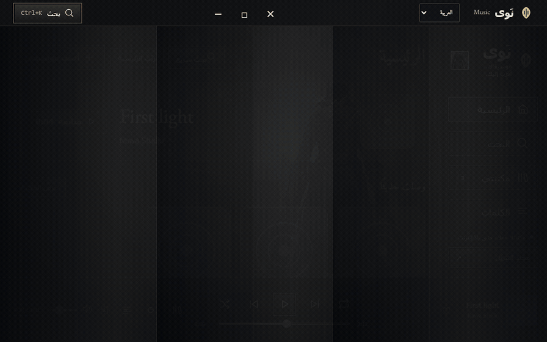
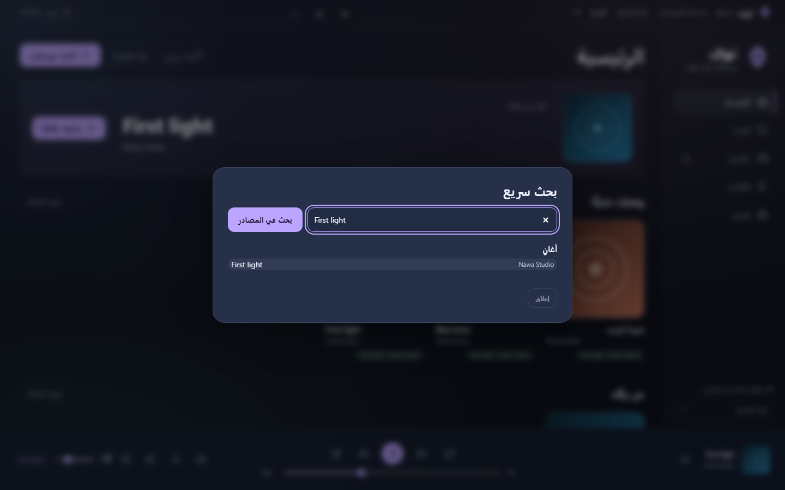
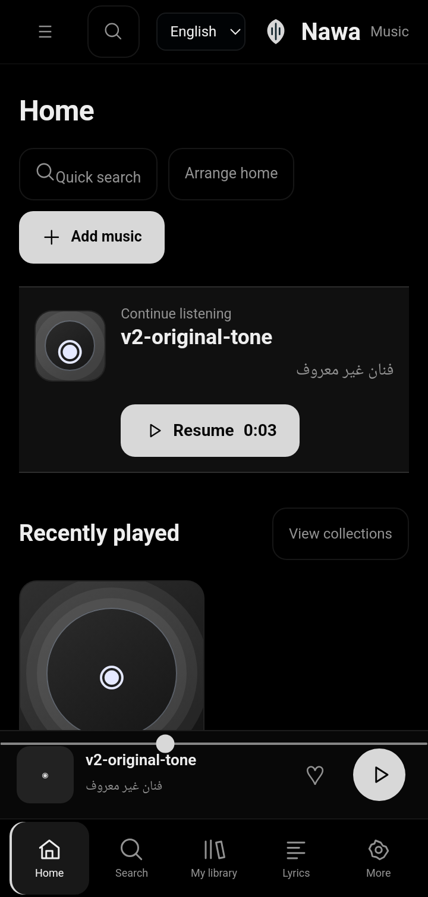
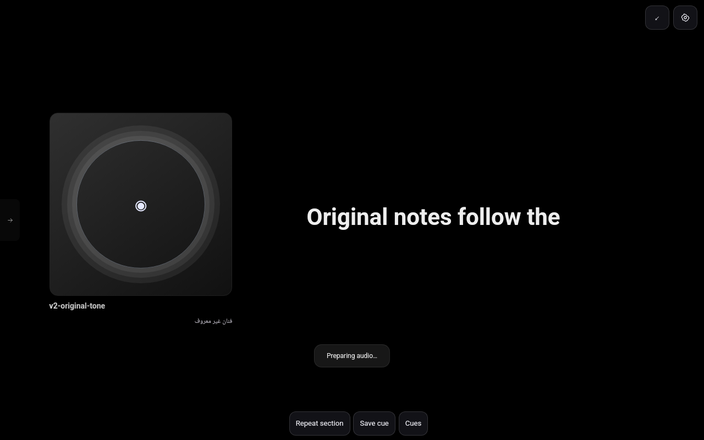

# نَوى 3.0 · Nawa Music

مشغّل موسيقى مستقل لويندوز وأندرويد، بمكتبة محلية وشاشة كلمات متزامنة.

**[حمّل APK لأندرويد](https://github.com/NSXI/music/releases/latest/download/Nawa-Android-Samsung-arm64.apk)** · **[حمّل ZIP لويندوز](https://github.com/NSXI/music/releases/latest/download/Nawa-Windows-x64.zip)**

[شرح التثبيت والتحديث](docs/INSTALL-AR.md) · [جديد 3.0](docs/RELEASE-3.0-AR.md) · [نتائج الاختبار](docs/VALIDATION-3.0-AR.md) · [جميع الإصدارات](https://github.com/NSXI/music/releases)

## ثبّت نَوى

| الجهاز | خطوات التثبيت |
| --- | --- |
| Android 9 فأحدث بمعالج ARM64 | [حمّل APK](https://github.com/NSXI/music/releases/latest/download/Nawa-Android-Samsung-arm64.apk)، افتحه من التنزيلات ووافق على التثبيت. ثبّته فوق نسختك الحالية للحفاظ على المكتبة والإعدادات. |
| Windows 10 أو 11 بنظام x64 | [حمّل ZIP](https://github.com/NSXI/music/releases/latest/download/Nawa-Windows-x64.zip)، فكّه بالكامل وشغّل `Nawa.exe` من المجلد. يحتاج التطبيق WebView2. |
| تحديث النسخة المثبتة | من **المزيد ← الإعدادات والمصادر ← التحديثات** افحص الإصدار ونزّله. أندرويد يطلب موافقة النظام بعد فحص الحزمة. |

تجد خطوات الترقية مع الاحتفاظ بالبيانات، والمحركات الاختيارية، وحلول مشاكل التثبيت في [دليل التثبيت](docs/INSTALL-AR.md).

## أين أجد الميزات؟

| أبغى أسوي | المكان داخل نَوى |
| --- | --- |
| أضيف مكتبتي وأرتّبها | **المكتبة** لاستيراد الملفات والمجلدات، والألبومات، والمفضلة، والقوائم والجينرا. افتح **تنظيم المكتبة** لمراجعة النسخ المتشابهة والملفات المنقولة. |
| أبحث وأسمع قبل التحميل | **البحث** للمصادر المتاحة ومعاينة النتيجة ومقارنة النوع والجودة والحجم حين يوفّرها المصدر. `Ctrl+K` يبحث سريعًا داخل المكتبة ويفتح البحث في المصادر. |
| أعرض الكلمات والترجمة | **الكلمات ← ملء الشاشة** للمسرح والتركيز واللغتين والكاراوكي. عدّل خلفية العرض والخطوط والحركة، واحفظ التصميم للأغنية أو الألبوم. افتح المشغّل من اليسار. |
| أضبط توقيت أغنية أو أصدّرها | **المزيد ← استوديو الكلمات** لتحليل التوقيت بطلبك ومراجعة الكلمات عند مواضعها، وتعديل الترجمة والنطق. يدعم LRC وTTML وSRT وفيديو MP4. |
| أسمع وأقرأ الكلمات بلا إنترنت | **المكتبة ← أوفلاين** لحفظ قائمة أو ألبوم مع الأغلفة والكلمات والترجمة المتوفرة. اختر حد المساحة وراجع حالة الملفات. |
| أكمّل على جهاز آخر | **المزيد ← الأجهزة** لربط جهازين على نفس الشبكة ومتابعة الموضع والطابور عند توفر المسارات على الجهاز الثاني. يدعم مزامنة المفضلة والقوائم والكلمات المعدّلة. |
| أضبط الصوت والمظهر | **المزيد ← استوديو الصوت** للموازنة، والإيكولايزر، والسرعة، والطبقة، والريفيرب والتداخل. **المظهر والحركة** للثيمات والألوان. |

## معاينات من التطبيق

### شاشة الكلمات

شاهد حركة الكلمات والترجمة

شاهد إعدادات تصميم شاشة الكلمات

### استوديو التوقيت

شاهد دخوليات الثيمات

شاهد البحث السريع

شاهد واجهة الهاتف والتابلت

الصور من نَوى 3.0 بمكتبة تجريبية. ملفات GIF تعمل بـ25 إطارًا في الثانية للمعاينة. أداء التطبيق الفعلي يتبع إعدادات الشاشة والجهاز. جودة البث والتنزيل تعتمد على المصدر، وتوفر ميزات الصوت مثل Dolby يعتمد على الجهاز ومسار الإخراج. [نتائج الاختبار وحدوده](docs/VALIDATION-3.0-AR.md)

## English

Nawa 3.0 is a bilingual Windows and Android music player with a local library, synchronized lyrics and translations, offline packs, LAN playback handoff, and optional audio-based lyric alignment. [Download for Windows](https://github.com/NSXI/music/releases/latest/download/Nawa-Windows-x64.zip) or [Android](https://github.com/NSXI/music/releases/latest/download/Nawa-Android-Samsung-arm64.apk). Install the signed APK over an existing Nawa installation to keep your data. [Installation and troubleshooting](docs/INSTALL-AR.md)

## المصدر والتراخيص

تجد مصدر ويندوز في `desktop/` ومصدر أندرويد في `android/`. تراخيص الأدوات والخطوط والأصول في [ويندوز](desktop/THIRD-PARTY.md) و[أندرويد](android/THIRD-PARTY.md). [طريقة البناء والنشر](docs/PUBLISHING-AR.md)
