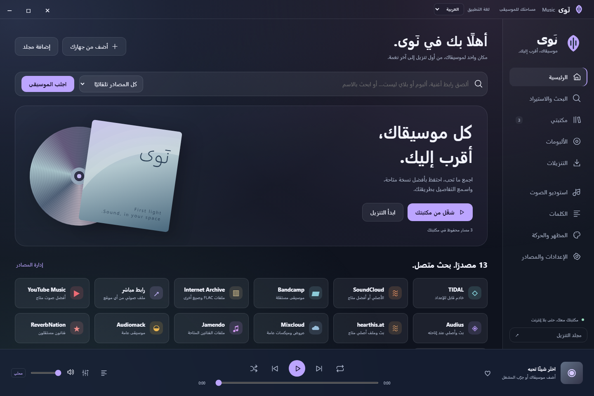
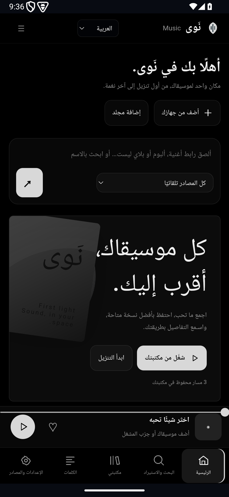
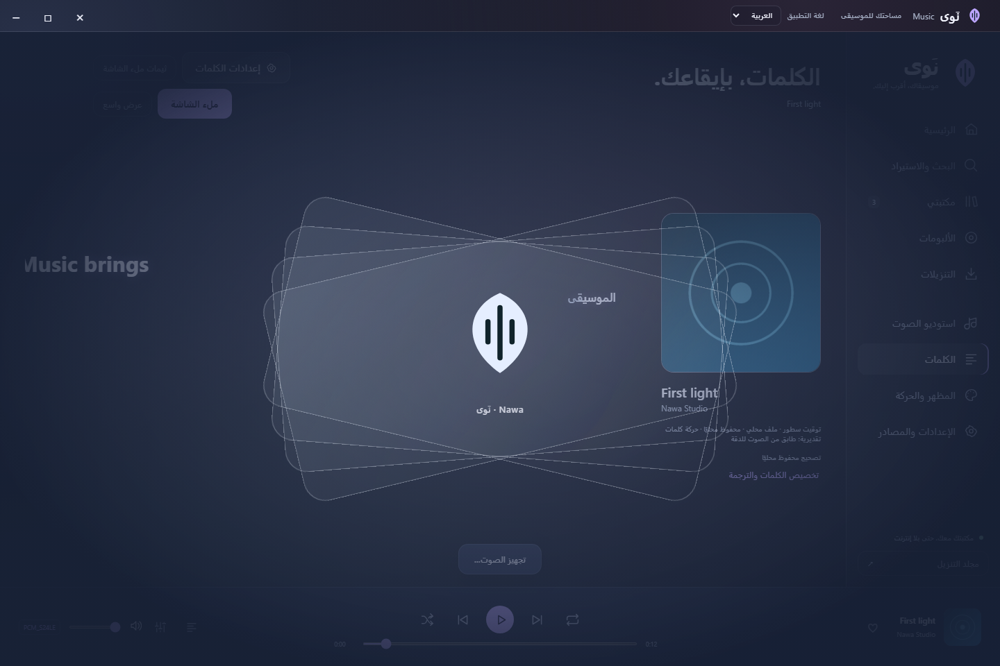
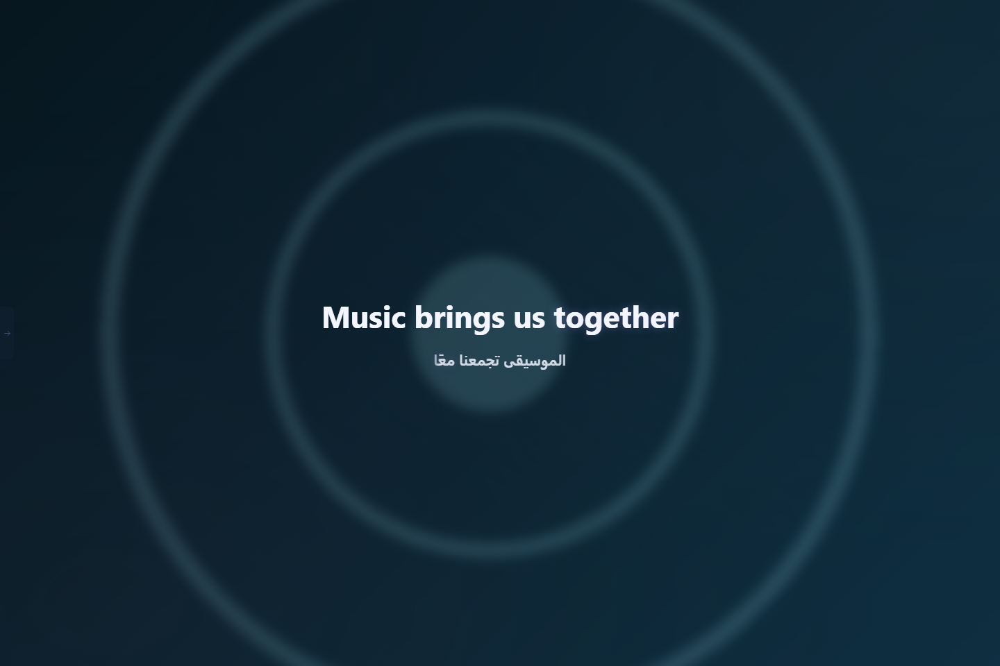

# تثبيت نَوى وترقيته

## Windows

1. افتح [Releases](https://github.com/NSXI/music/releases) ونزّل `Nawa-Windows-x64.zip` من الإصدار المطلوب.
2. فك ضغط المجلد كاملًا إلى مكان تستطيع الكتابة فيه، مثل مجلد البرامج الخاص بك. لا تشغّل EXE من داخل ZIP.
3. افتح `Nawa.exe`، وأبقِ مجلدي `tools` و`licenses` بجانبه. أدوات الصوت والنماذج المرفقة جزء من الحزمة.
4. التطبيق يحتاج WebView2. إذا لم يكن موجودًا، ثبّت [WebView2 Runtime الرسمي من Microsoft](https://developer.microsoft.com/microsoft-edge/webview2/).
5. اختر العربية أو English، وأضف ملفات أو مجلدًا من صفحة المكتبة.

للترقية، أغلق نسختك بنفسك ثم استبدل الملفات التنفيذية والأصول من الإصدار الجديد، مع الإبقاء على `data` وتنزيلاتك. الحزمة النظيفة لا تتضمن بيانات مستخدم جاهزة. مسار التحديث المحلي لا يغلق تطبيقك قسرًا؛ إذا كان EXE مستخدمًا يحفظ ملفًا محدثًا باسم آخر بجانبه.

## Android وSamsung

1. نزّل `Nawa-Android-Samsung-arm64.apk` من [Releases](https://github.com/NSXI/music/releases).
2. افتحه من مدير الملفات. إذا طلب النظام ذلك، اسمح بالتثبيت من مدير الملفات الذي استخدمته، ثم ثبّت APK.
3. اسم التطبيق **نَوى · Nawa**. نسخة ARM64 واحدة للجوال والتابلت، Android 9 فأحدث، ومنها Galaxy S10+ وGalaxy Tab S10 Ultra.
4. استخدم زر ☰ للوصول لكل الصفحات. يتغير التنقل والتخطيط حسب عرض النافذة، ويدعم التابلت والوضع الأفقي وتقسيم الشاشة.
5. اختر الملفات أو المجلدات عبر منتقي أندرويد. تُنسخ الملفات إلى مكتبة التطبيق وتبقى الأصول في مكانها. يمكنك إعادة الفحص أو الإلغاء.
6. من «الإعدادات والمصادر» تجد قسم أندرويد: استيراد خط TTF/OTF، وتصدير المكتبة، وتنزيل نموذج التوقيت.

للترقية ثبّت APK الجديد فوق النسخة الموجودة. يجب أن يكون بنفس معرف التطبيق ومفتاح التوقيع. **لا تحذف التطبيق قبل الترقية** إذا أردت الاحتفاظ ببياناته الداخلية؛ صدّر نسخة من ملفاتك عند الحاجة.

 

## الكلمات والترجمة

1. شغّل مسارًا من مكتبتك وافتح «الكلمات».
2. اجلب الكلمات من المصدر أو أضف LRC/نصًا محليًا.
3. من إعدادات الكلمات اختر لغة الأصل ولغة الترجمة، ثم فعّل الترجمة. العربية مدعومة مع لغات أخرى.
4. أندرويد ينزّل نموذج اللغة أول مرة عبر ML Kit؛ بعدها يعمل محليًا. النص المترجم يُحفظ ويمكن تصحيحه.
5. لتنقيح التوقيت على أندرويد، نزّل نموذج Whisper base من قسم أندرويد. حجمه **147,951,465 بايت**؛ يُتحقق من بصمته قبل اعتماده.
6. نتيجة التوقيت مقترح يحتاج مراجعة وتطبيقًا؛ إذا لم تتطابق الكلمات أو كانت الأزمنة غير موثوقة يبقى الأصل محفوظًا. الحروف داخل الكلمة تحريك بصري.

## الشاشة الكاملة والثيمات والخطوط

من إعدادات الكلمات اختر الخلفية والشكل والحركة والخطوط، ثم افتح ملء الشاشة. لديك خلفية الغلاف، وOLED، ودمج الثيم وخيارات أخرى. درج المشغل يظهر بالزر أو بالمؤشر ويمكن تثبيته. Escape أو الرجوع يغلق الإعدادات قبل الخروج من الشاشة الكاملة.

الخط الأصلي والترجمة مستقلان. معاينة الخط لا تثبّته في النظام ولا تعني أن كل أحرف اللغات موجودة فيه. على أندرويد قد لا تتاح خطوط حزم الثيمات الخاصة؛ استورد ملف خط مناسبًا إذا احتجت.

## التنزيل والجودة

ألصق رابطًا أو ابحث بالاسم، واختر المصدر أو البحث المجمع. مصدر الصوت وتوفر الملف هما اللذان يحددان الجودة؛ تحويل ملف lossy إلى FLAC لا يضيف تفاصيل مفقودة. Spotify مصدر بيانات وقوائم، وقد يتطلب إعداد تطبيق وحسابك حسب الصلاحيات. TIDAL يحتاج مصدرًا متاحًا ومصرحًا لك؛ لا توجد حسابات أو مفاتيح مشتركة مضمّنة، ولا يُتجاوز تشفير الملفات.

على أندرويد تبقى النسخة الأساسية داخل التطبيق. اختيار مجلد التنزيل يفعّل تصدير نسخة من التنزيلات الجديدة إليه. «تصدير المكتبة» ينسخ الملفات الحالية والأغلفة والكلمات المتاحة، ويحافظ على الملفات الموجودة.

## تحديثات التطبيق

الفحص تلقائي عند فتح التطبيق ثم كل ساعة أثناء استخدامه. يمكنك الفحص يدويًا من «الإعدادات والمصادر»، وعرض الإصدار والبصمة والتنزيل المناسب لجهازك. على الجوال يُنزّل APK داخل نَوى، مع إيقاف واستئناف وفحص البصمة واسم الحزمة والإصدار وتوقيع المطور وتوافق المعالج. اضغط «تثبيت التحديث»؛ إذا طلب أندرويد الإذن اسمح لنَوى بتثبيت التحديث ثم ارجع وأكمل نافذة التثبيت. تظل موافقة النظام مطلوبة، ويُثبت التحديث فوق النسخة الحالية دون حذف بياناتها. يمكن متابعة الملف المحفوظ لاحقًا من إعدادات التحديث حتى بعد إغلاق التطبيق. يحتاج التنبيه نشر `nawa-update.json` والحزمتين في GitHub Releases أولًا؛ لا يبدأ بمجرد وجود مستودع مصدر.

يمكن تغيير رابط ملف التحديث أو إفراغه لتعطيل الفحص. لا يلزم تسجيل دخول GitHub إذا كانت الإصدارات عامة. الفحص لا يغيّر مكتبتك ولا يثبت برامج تلقائيًا.

## أسئلة سريعة

- **هل كل الصيغ تعمل؟** يدعم المشغل صيغ الصوت الشائعة ويفك صيغًا إضافية عبر FFmpeg عند الإمكان. الملفات التالفة أو المحمية أو MIDI دون مُركّب مناسب ليست مضمونة.
- **أين Dolby وHi-Res؟** جودة المصدر محفوظة، لكن إخراج الجهاز والسماعات والنظام هو الذي يحدد النتيجة. افتح إعدادات صوت الجهاز من التطبيق إذا كانت الميزة متاحة.
- **هل التوقيت والترجمة دقيقان دائمًا؟** لا. راجع المقترح، واختر لغة الأصل الصحيحة، واحتفظ بتوقيت المصدر عند عدم الثقة.
- **هل يحتاج إنترنت؟** البحث والجلب والتنزيل وتنزيل النماذج أول مرة والتحديثات تحتاج إنترنت. المكتبة والكلمات والترجمات والأغلفة المحفوظة تعمل محليًا.
- **هل الثيم الزجاجي شفاف لنظام الجوال؟** الزجاج داخل واجهة أندرويد؛ ليس نافذة Windows شفافة على خلفية النظام.
